# The David Lynch Collection

**David Lynch's world, in 441 objects.** An interactive study of every lot in his estate sale at Julien's Auctions: what each one was estimated at, what it sold for, and how far the room went past the estimate.

**[Visit the live site →](https://lynch.hassan-odimi.se)**

<p align="center">
  <a href="https://lynch.hassan-odimi.se">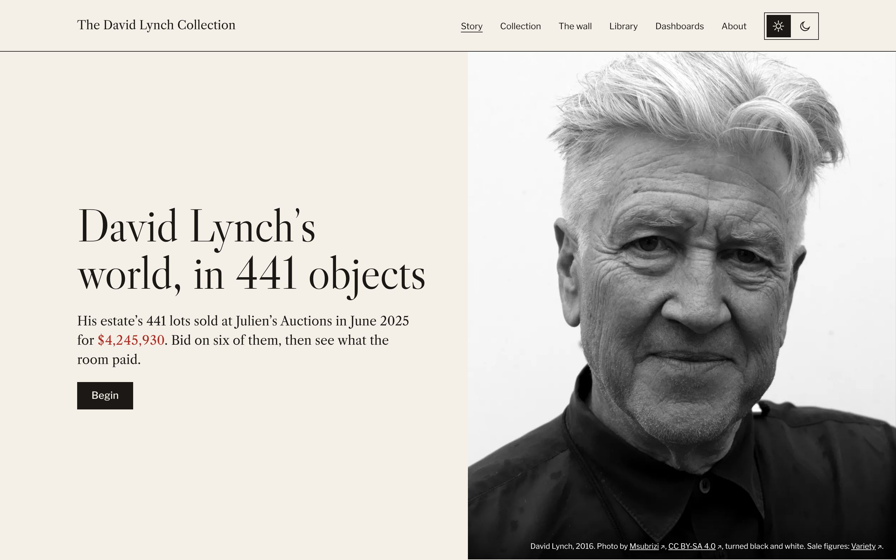</a>
</p>

## The sale at a glance

| | |
|---|---|
| **$4,245,930** | sold in total, across **441 lots** |
| **18.2×** | median sold price against the midpoint of the estimate |
| **440 of 441** | lots sold above their high estimate |
| **$195,000** | top price, a tie between the *Ronnie Rocket* and *Lost Highway* scripts, each 780× its midpoint |
| **1** | lot below estimate: a Vladimir Kagan Swan Back Sofa, $6,500 against $8,000 to $10,000 |

It is not known whether the sold prices include buyer's premium.

## What's on the site

| Page | What it does |
|---|---|
| **Story** | Six chapters (Wrote, Filmed, Painted, Built and furnished, Played, Read). Each one asks you to bid on a lot before showing what it sold for. |
| **The wall** | All 441 lots in one picture. You can arrange it by price, as a chart, by colour, or as a portrait of Lynch. |
| **Collection** | Every lot, with search, category and price filters, and a detail view for each one. |
| **Library** | The 287 books in the sale, shelved by subject and linked to Open Library. |
| **Dashboards** | Six tabs (Overview, Findings, Prices, Categories, Films, Books), each with its own shareable URL. |

## A tour

### Bid, then see what the room paid

Each chapter puts one lot in front of you. You place a bid on a log scale, and the site shows the sold price and how far yours fell short.

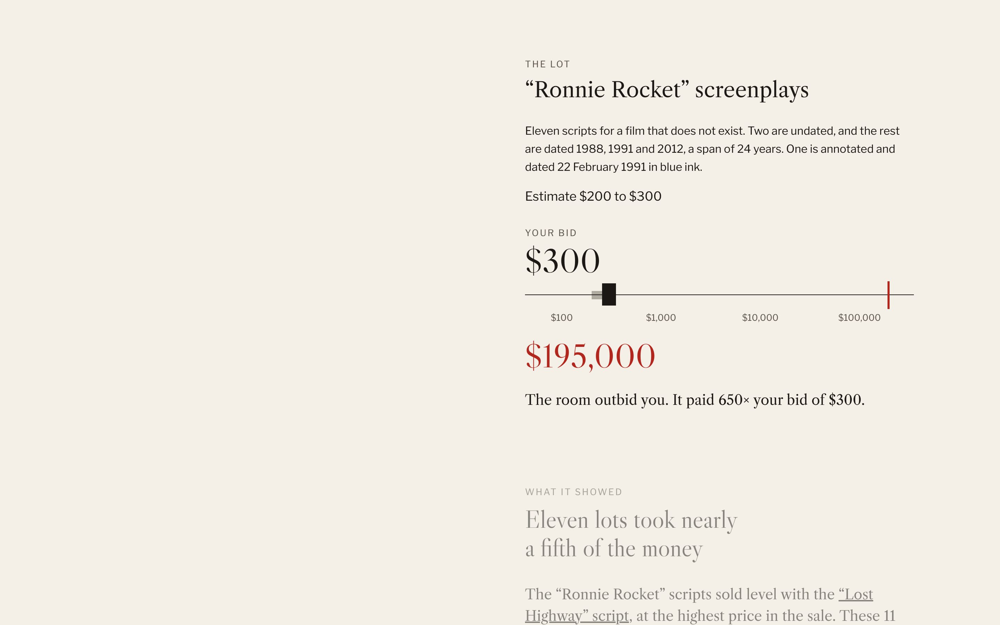

### The wall: one picture, four arrangements

<table>
  <tr>
    <td width="50%">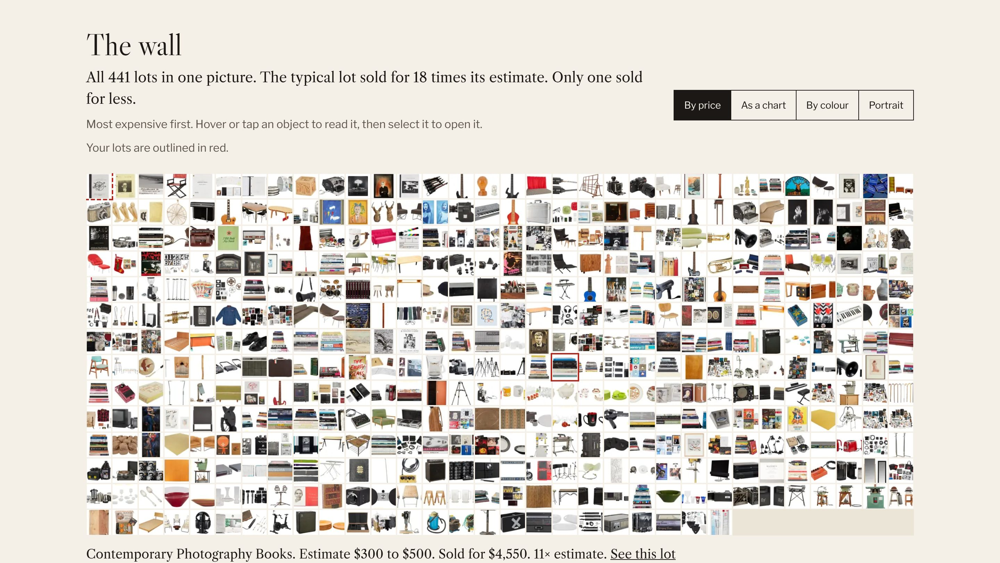<br><sub><b>By price.</b> Most expensive first.</sub></td>
    <td width="50%">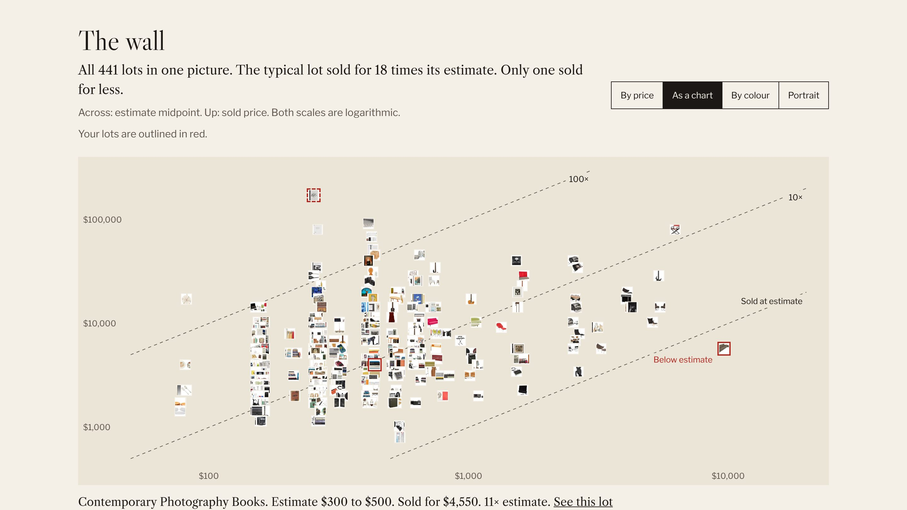<br><sub><b>As a chart.</b> Estimate against sold price. Only one object sits below the line.</sub></td>
  </tr>
  <tr>
    <td width="50%">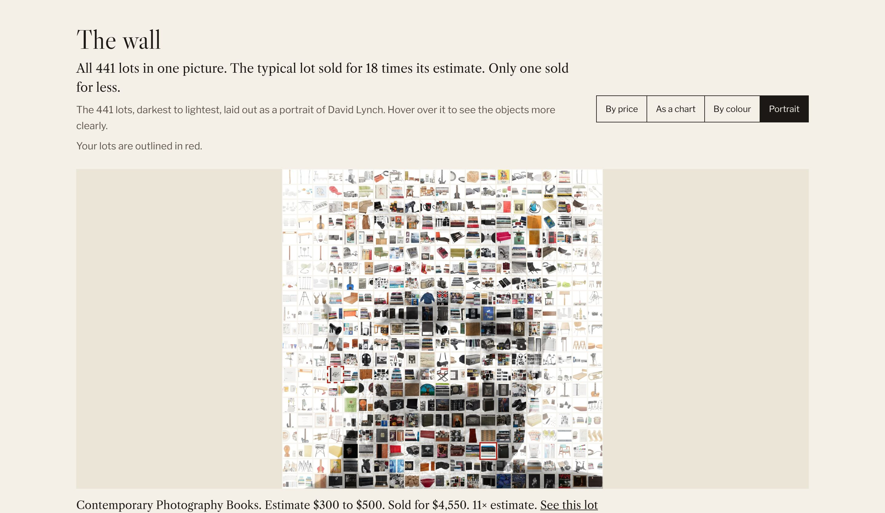<br><sub><b>Portrait.</b> The lots sorted dark to light to form his face.</sub></td>
    <td width="50%">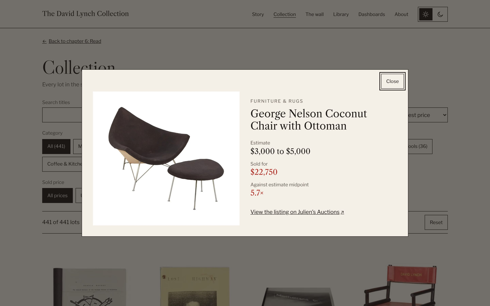<br><sub><b>Every lot opens.</b> Estimate, sold price, multiple and a link to the original listing.</sub></td>
  </tr>
</table>

### Dashboards

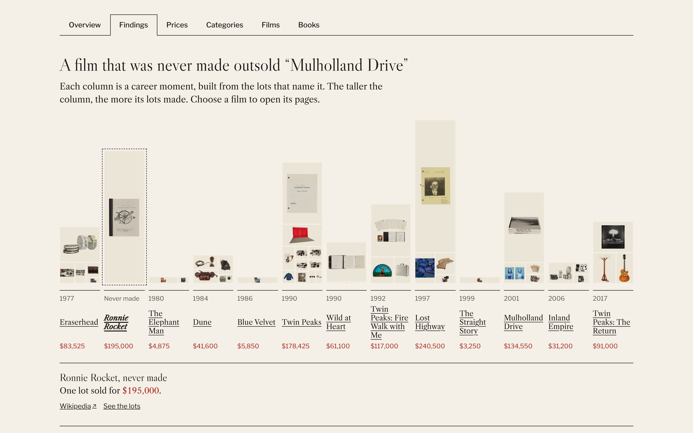

<sub><b>Findings.</b> A film that was never made outsold <i>Mulholland Drive</i>. Each column is built from the lots that name it.</sub>

<table>
  <tr>
    <td width="50%">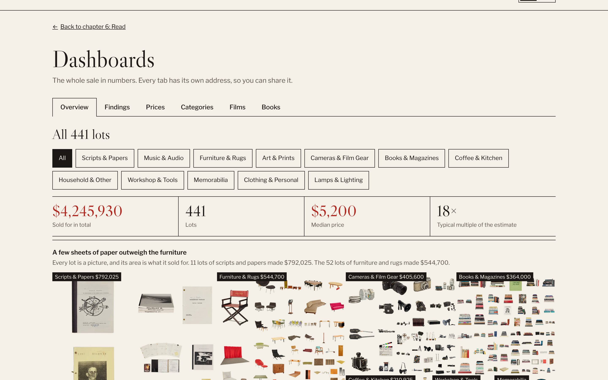<br><sub><b>Overview.</b> A treemap of images, each sized by what it sold for.</sub></td>
    <td width="50%">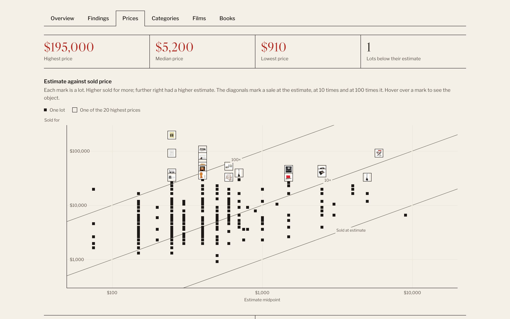<br><sub><b>Prices.</b> Estimate against sold price, with the top 20 shown as objects.</sub></td>
  </tr>
  <tr>
    <td width="50%">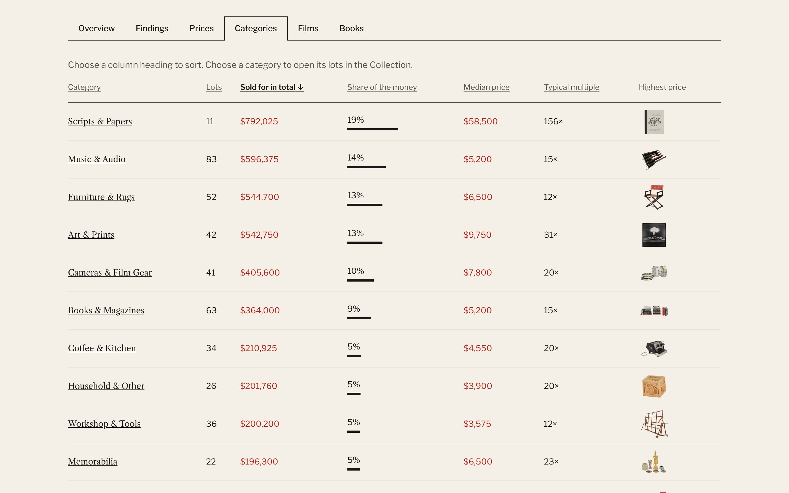<br><sub><b>Categories.</b> 11 lots of scripts took 19% of the money.</sub></td>
    <td width="50%">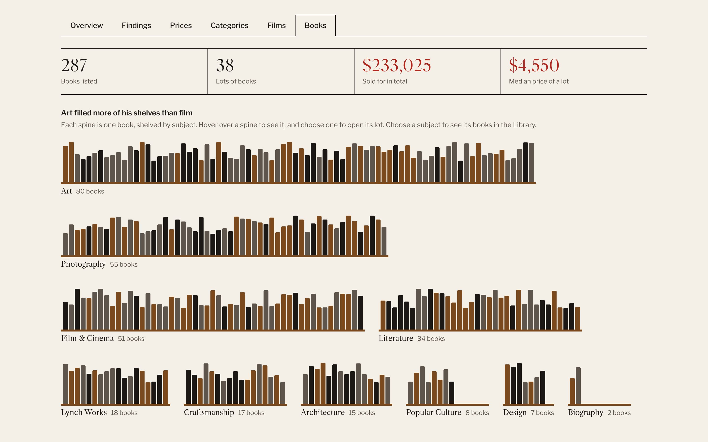<br><sub><b>Books.</b> Each spine is one book. Art filled more of his shelves than film.</sub></td>
  </tr>
</table>

### Library, and a dark mode

<table>
  <tr>
    <td width="50%">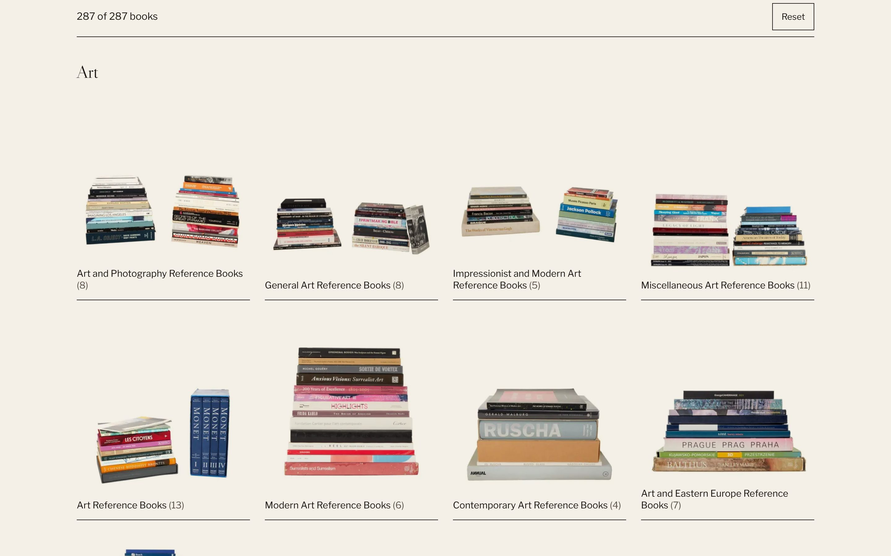<br><sub><b>Library.</b> 287 books in 38 lots, searchable by title and author.</sub></td>
    <td width="50%">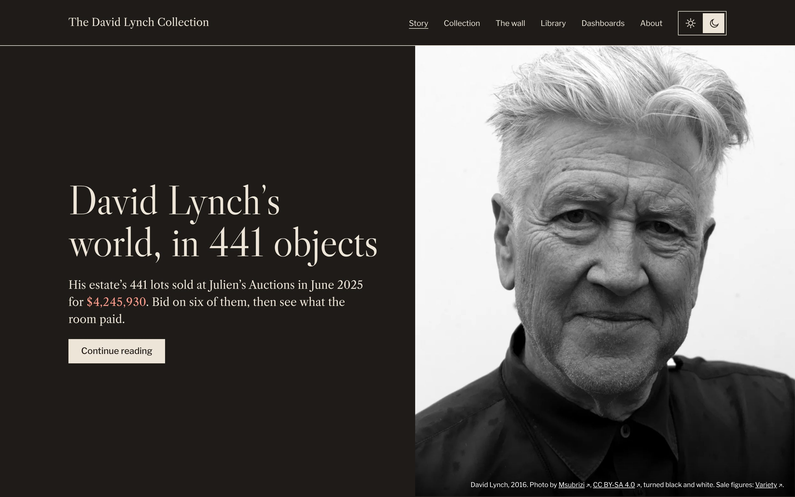<br><sub><b>Light and dark themes</b> throughout.</sub></td>
  </tr>
</table>

## How it's built

- **Plain HTML, CSS and JavaScript.** No framework and no build step. `site/` is the whole website.
- **Python data pipeline.** `scripts/build_data.py` uses only the standard library to turn the source JSON into the site's data, and `scripts/test_build_data.py` checks the published figures.
- **Hosting.** Cloudflare Pages.

```
site/                       the website (HTML, CSS, JS, data, images)
scripts/                    data build, image build and data tests
data/                       the two source JSON files
archived_auction_data/      original collection work
Lynch Collection Insights.ipynb
docs/screenshots/           images used in this README
```

## Run it locally

```bash
python3 -m http.server --directory site
```

Then open <http://localhost:8000>.

<details>
<summary><b>Rebuild the data and images</b></summary>

The scripts use Python 3. `build_data.py` needs only the standard library, and `build_images.py` needs Pillow.

Rebuild `site/data/` and check the published figures:

```bash
python3 scripts/test_build_data.py
```

Download the images again. Delete `site/img/lots` and `site/img/thumbs` first, because the script skips files that already exist.

```bash
pip install -r requirements.txt
python3 scripts/build_images.py
```

</details>

<details>
<summary><b>Deploy</b></summary>

The site is hosted on Cloudflare Pages, and `site/` is the folder to publish.

```bash
npx wrangler pages deploy site --project-name david-lynch-collection --branch main
```

</details>

## Source and credit

All auction data and lot images come from [Julien's Auctions](https://www.juliensauctions.com/en/auctions/julien-s-auctions-turner-classic-movies-present-the-david-lynch-collection). The portrait is by Msubrizi ([CC BY-SA 4.0](https://creativecommons.org/licenses/by-sa/4.0/)), converted to black and white. This is an independent study by [Hassan Odimi](https://www.hassan-odimi.se) and is not affiliated with Julien's Auctions.

The earlier Streamlit version is kept at the git tag `streamlit-v1`.

## Licence

The code is under the MIT licence. It does not cover the data or images. See [LICENSE](LICENSE).
